# Generative AI Declaration

**Student Name:** Tan Yi Chin
**Student ID:** 105685017
**Assessment:** Individual Project Reflection  
**Date:** 11/11/2026  
**AI Tool Used:** ChatGPT

## Purpose of AI Use

I used Generative AI to support my understanding of KNIME data processing, D3.js programming and visualisation design for the Population Comparison page. I generally requested guidance rather than direct uses AI-generated answer so that I could implement and understand the adjustment myself.

## Key Topics I Asked About

- **KNIME data processing:** Selecting worksheet ranges, combining half-year records, handling unpublished values and concatenating cleaned breakdowns into one table.
- **Percentage calculations:** Checking that all required categories had published annual counts, calculating within-population percentages and joining the results back to the cleaned dataset.
- **D3.js programming:** Drawing paired and stacked bar charts, positioning labels and connecting charts to filters.
- **Chart responsiveness:** Using `ResizeObserver` to redraw charts when their containers changed size.
- **Shared components:** Clearing duplicated tooltip content and reusing header, navigation, footer, legend, tooltip and colour settings.

## Declaration

I acknowledge all AI-generated explanation, code suggestions and debugging were reviewed, modified where necessary and integrated responsibly into the project.

I understand the concepts and code used in this project and can explain the purpose of each element and interaction I implemented.

The prompts and AI-generated responses are recorded below to show how I used Generative AI to support my learning, debugging and project development.

## Evidence of AI Use

**Question 1:**
when i use excel reader to read my raw dataset, it results in empty column why? how should i read it correctly?

**Answer 1:**

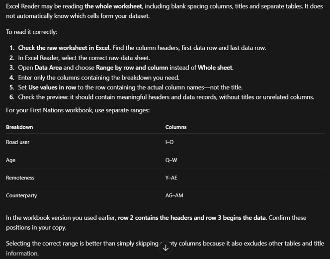

---

**Question 2:**
Why the bar chart disappearing or getting cut off on smaller screens, and how to fix the CSS Flexbox layout?

**Answer 2:**

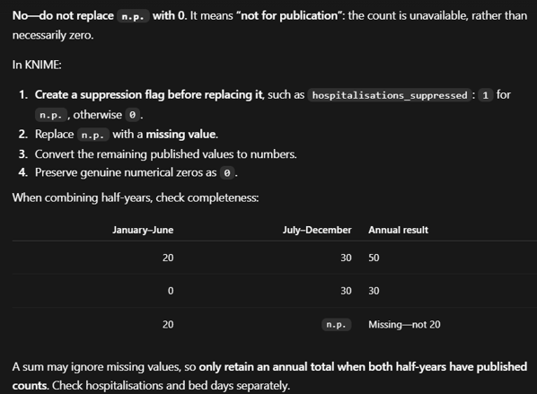

---

**Question 3:**
how can i combine all seperated clean data into one excel?

**Answer 3:**

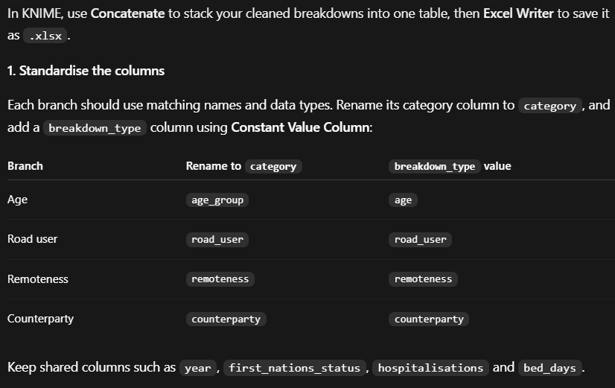
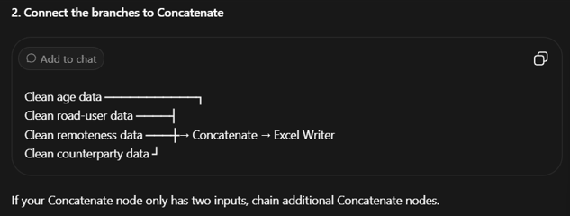

---

**Question 4:**
When i turn from halfscreen size to full screen size, my chart looks weird, i will need to refresh only it will change the sizing. why does this happen? how can i fix this?

**Answer 4:**

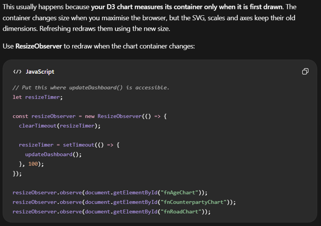
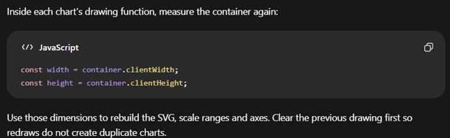

---

**Question 5:**
What happen? why my tooltips have duplicate information? how should i fix this?

**Answer 5:**
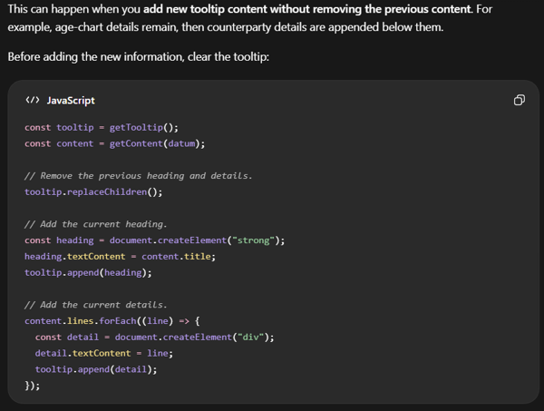
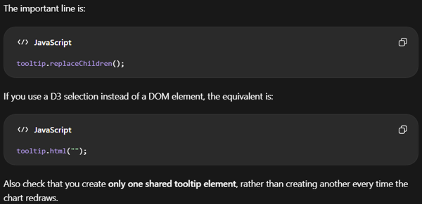

---

**Question 6:**
DO you think i can move the header, footer and navigation menu since we they need to remain consistent across all pages and i dont want to repeat coding them?

**Answer 6:**
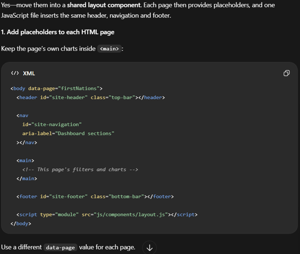
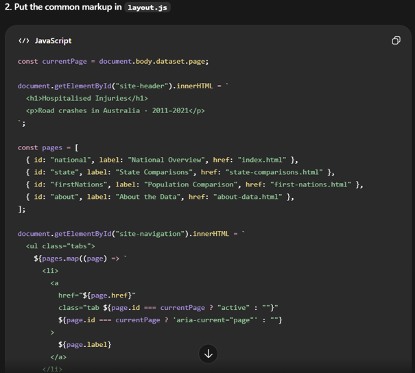
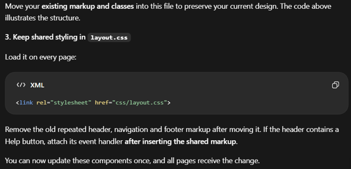
