# Generative AI Declaration

**Student Name:** Eva Lew Tze Ling  
**Student ID:** 105685143  
**Assessment:** Individual Project Reflection  
**Date:** 11/11/2026  
**AI Tool Used:** Deepseek AI

### Purpose of AI Use
I used Generative AI as a programming guide and debugging tool to help troubleshoot technical issues in CSS and D3 codes. I did NOT use AI to generate the entire chart or write my KNIME workflow. All AI-generated code snippets were reviewed, modified, and tested by me before the submission.

### Key Topics I Asked About
* **CSS Flexbox Debugging:** Understanding how to use `display: contents` and `order: -1` to make the National Overview KPI cards and charts on mobile screens to be responsive.
* **D3.js Axis Manipulation:** Finding the correct SVG syntax to rotate the x-axis text labels (`.attr("transform", "rotate(-45)")`) so they will not overlap on the x-axis of the line chart.
* **JavaScript Responsiveness:** Understanding how to implement a `ResizeObserver` to trigger chart redraws when the browser window is being resized.
* **Data Processing Logic:** Asking for advice on what node to use on KNIME and how to flag specific years based on the time series break for the `data_quality_flag` column.

### Declaration
All code structure, styling, dashboard design, and KNIME workflow decisions are done on my own. I fully understand every component of my submission. I can explain my decisions without relying on AI during the presentation. Screenshots of my AI interactions are attached as evidence of responsible AI use.

---

## Evidence of AI Use

**Question 1:**
my KPI cards and charts are overlapping with each other on mobile screens. How can I use CSS display:contents and order:-1 to stack and rearrange the cards so the KPI cards is at the top on smaller screens instead without needing to duplicate my HTML code?

**Answer 1:**

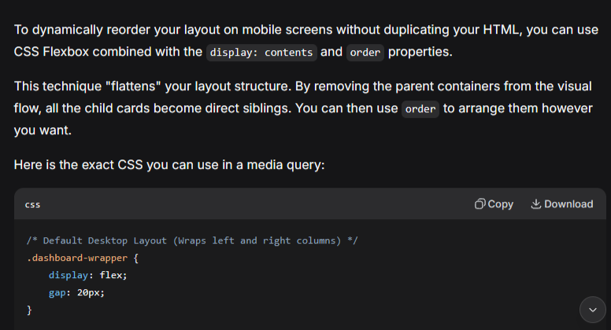
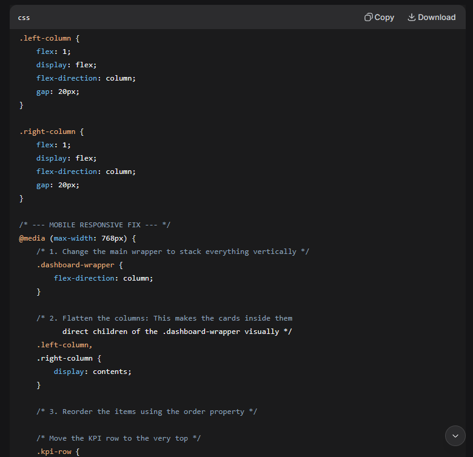
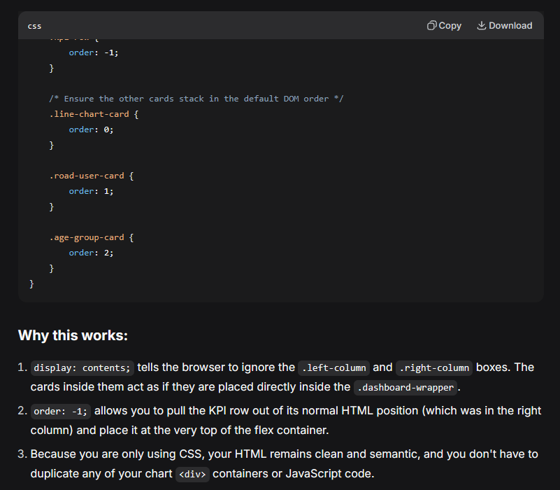

---

**Question 2:**
In my line chart, the x-axis year labels are overlapping on smaller screens. What is the SVG code that uses .attr("transform", "rotate(...)") that rotate the text labels by -45 degrees and anchor them to the end so that they don't overlap?

**Answer 2:**

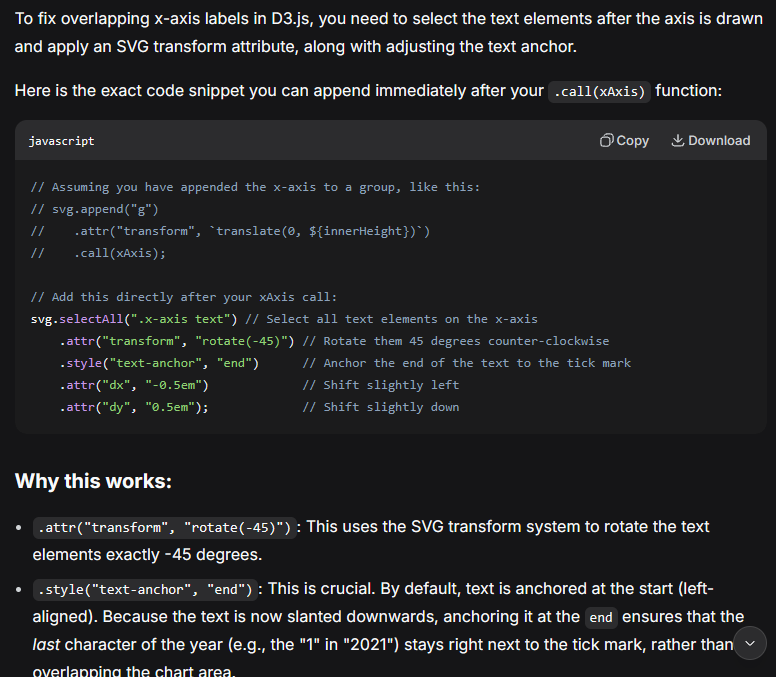
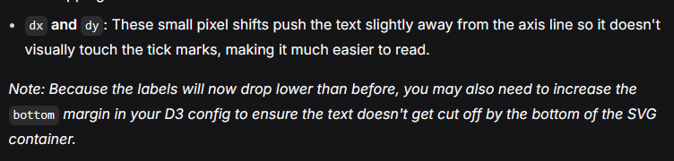

---

**Question 3:**
when I change the size of my browser window, my D3 charts will overflow and is not scaling. explain to me on how to use a ResizeObserver in JavaScript to watch the chart container's width and trigger a redraw function with delay when screen size changes?

**Answer 3:**

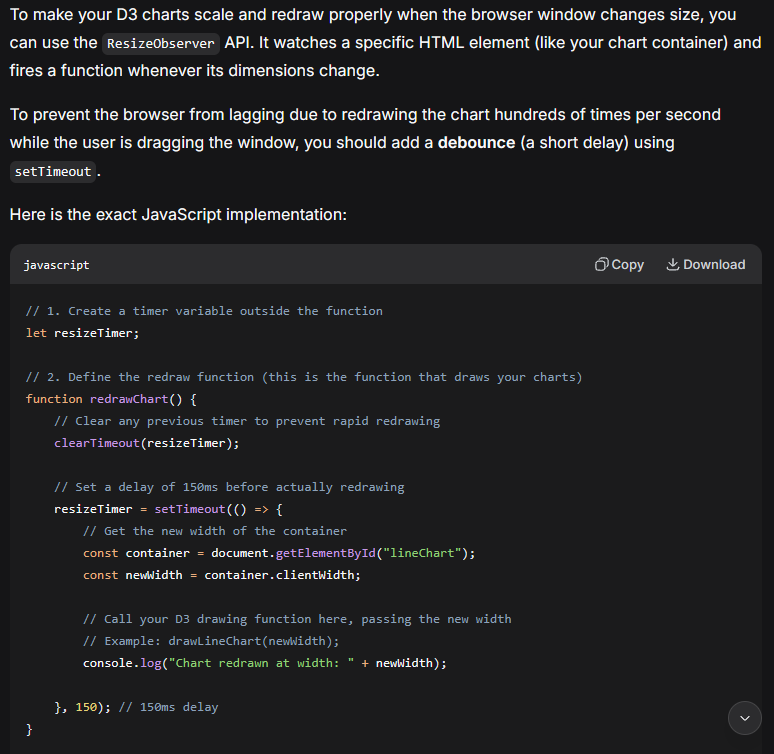
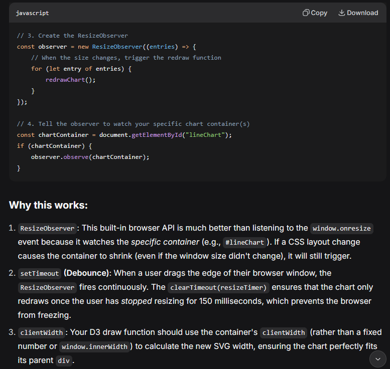

---

**Question 4:**
I am cleaning a dataset in KNIME. I want to create a column called data_quality_flag and i want to make it when year is 2012 then it is 'National_break_2012' and 2017 is 'National_break_2017', while leaving all other rows blank. what do i use and how do i set that condition?

**Answer 4:**

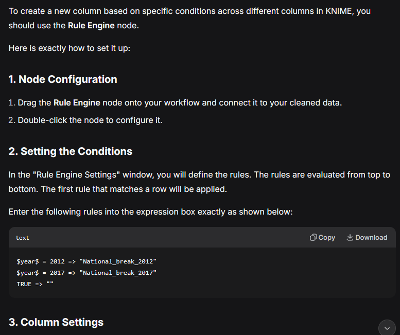
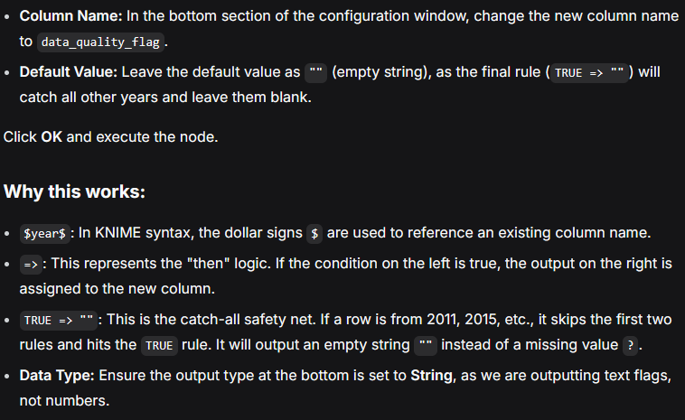

---

**Question 5:**
i want to draw a dotted red line vertically and a text label at the years 2012 and 2017 on my line chart and make it based on the data_quality_flag column in my cleaned data CSV. how do I filter my data for these flags and append the SVG elements to the chart?

**Answer 5:**

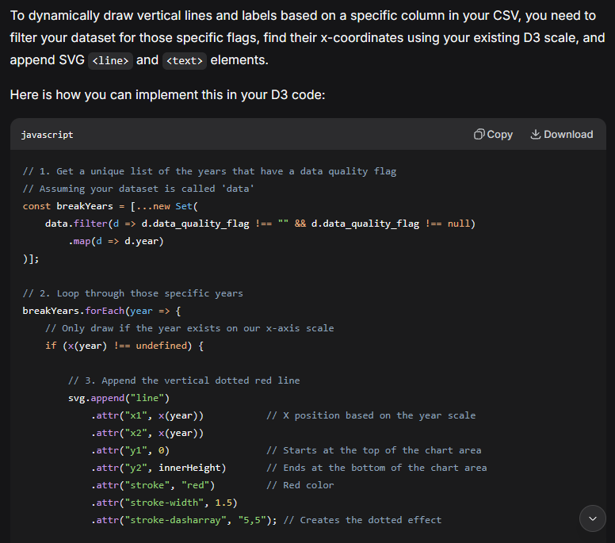
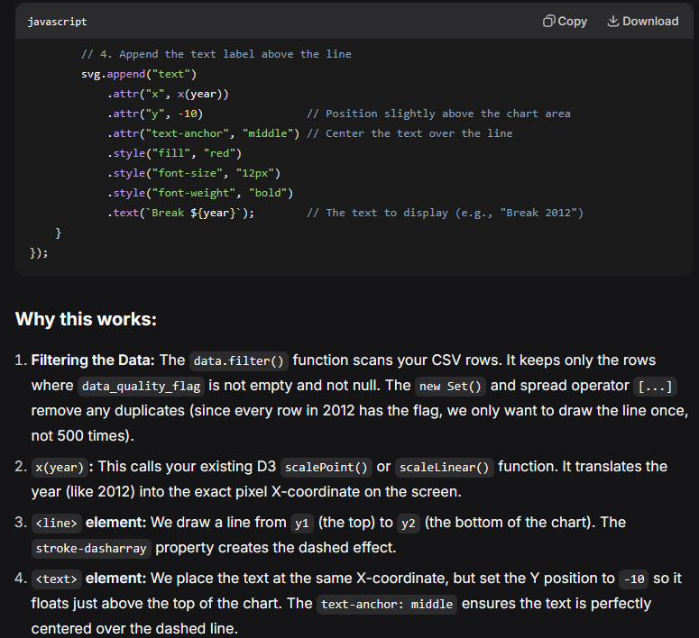